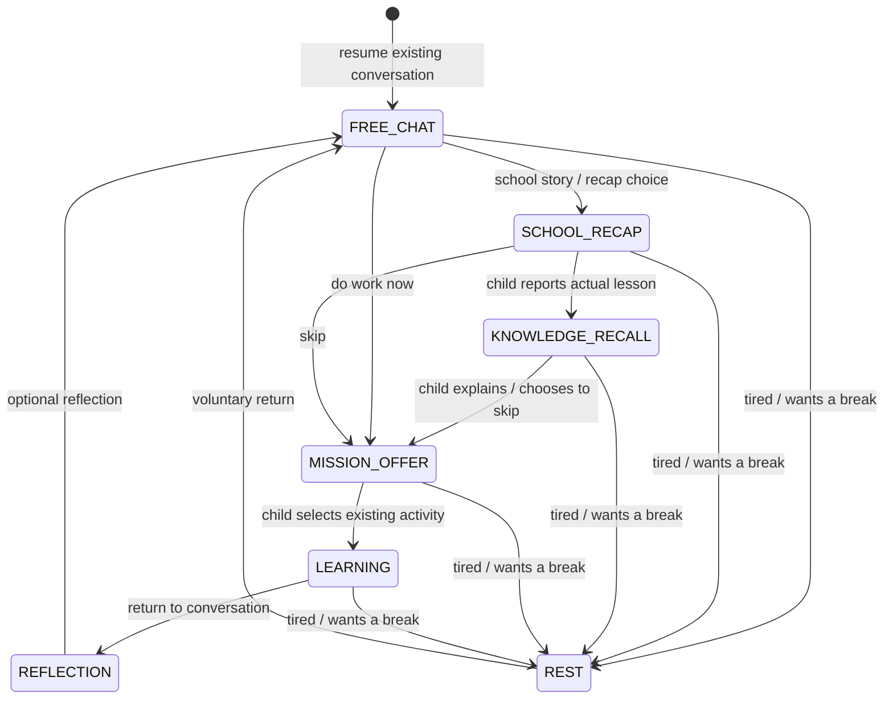

# Issue 47: chat before learning

Implemented independently from issue 45, on top of `main` at `716428c`.
The repository owner explicitly authorized coding in the ChatGPT conversation after the design-only handoff.
This change does not deploy or merge anything.

## User flow

The child opens the chat, resumes the existing server conversation, and chooses freely between telling a happy story, school recap, immediate learning, or rest. These are conversation states, not separate screens. Parents can disable the chat landing page in Settings; the previous dashboard remains available.



The four choices appear initially and remain available through “Đổi hoạt động” after the conversation starts. Recap can be skipped, a different subject selected, and activities paused. Rest neither starts a task nor adds/deducts stars. A school story can also enter recap naturally from free text. The deterministic rules intentionally favor explicit requests; the model supplies the conversational wording, not grades, rewards, task execution or state transitions.

## Code boundaries and contracts

- `app/conversation_logic.php`: pure state transitions, explicit intent rules, expected timetable subjects, companion prompt.
- `app/conversation.php`: authenticated session, turn, checkpoint, and activity resume endpoints. Uses existing `conversations` and `messages` history, existing subject catalog and learning engines.
- `public/conversation.js` / `.css`: chat shell and responsive workspace. Existing learning renderers and their event handlers are moved into the workspace; no second renderer, grader or reward engine is introduced.
- `public/api.php`: routes and minimal integration with existing reading/listening/word-problem generators. Child-reported lesson context can take precedence over the weekly plan when choosing practice.

`POST /api/companion/session` returns `{session: {id, revision, state, messages}, context, stars}`. It creates one greeting only when no retained companion conversation exists. Messages are bounded to the last 80 in the child UI; parents can inspect the retained transcript through their existing protected endpoint.

`POST /api/companion/turn` accepts `{session_id, revision, request_id, type, text?, subject_key?, card?}`. Types are allowlisted. Subject keys and card modes are resolved against the server catalog. The server serializes companion changes, rejects stale revisions, and remembers request nonces to prevent duplicate turns after an uncertain network response. Successful requests commit user message, assistant reply, evidence and state together. Quick actions need no model call.

`POST /api/companion/checkpoint` saves only the existing activity reference, with revision/view/subject/kind validation. `POST /api/companion/activity` restores server-owned quiz answers/progress, writing, reading, listening, word problems, speaking attempts, or subject chat. Unanswered quiz solutions remain hidden. Restore does not grade or award. Review uses the existing spaced-repetition list. No raw audio or photos are checkpointed.

Schema version 14 adds two tables with cascading foreign keys to `conversations`: `companion_sessions` and `companion_events`. Existing tables and scores are preserved. The standard application schema initialization applies the additive migration on first use.

## Timetable, evidence and privacy

The timetable is read directly from the parent's existing grid or legacy timetable, using the configured server date/timezone. Repeated periods are deduplicated without inventing subjects. Empty schedules do not imply either a school day or a holiday; confirmed holiday dates can be configured through `school_days_off`. A weekend with configured classes remains a valid schedule.

The schedule is explicitly labeled **expected**, including the old `day_plan()` prompt note. A child's correction clears the assumed subject for that recap; it does not overwrite the parent's recurring timetable. Reopening recap on the same day advances past already asked subjects without requiring every subject to be covered. A new day resets daily recap context and preserves the unfinished activity.

Lesson reports, optional recall and reflection contain `source: child_report`, `verified: false`, and the originating user message ID. They are not mastery scores. Model-generated text never becomes child evidence. The existing checks/mastery engine is unchanged. Parents can inspect today's structured context and the retained transcript, and delete them through the existing chat deletion action.

The existing nightly cron now expires old messages and retry keys even if the companion conversation stays active, and removes expired structured context. Conversation data follows `chat_retention_days`; backups retain their existing independent policy. On the device, only bounded unsent text fields, pending turn/checkpoint metadata and their expiration are cached. Raw audio, photos, the full transcript and activity answer keys are not copied into the draft cache. Deleting chats on this device clears drafts immediately; after deletion from another device, a successful server refresh invalidates the old session's draft. An offline device cannot learn about a remote deletion until it reconnects.

## Validation

Automated tests use a disposable local MariaDB database and a copied PHP app with a fake model boundary; no paid model calls or production credentials are used. They check state policy, actual API/database behavior and Chromium rendering. Run only against the dedicated test database:

```sh
# Create an empty local database named may_issue47_test on port 3307 first.
python3 tests/prepare_integration.py /tmp/may-issue47-test
php /tmp/may-issue47-test/tests/conversation_test.php
php -S 127.0.0.1:8082 -t /tmp/may-issue47-test/public /tmp/may-issue47-test/tests/router.php
# In another terminal, with Playwright available to Node:
python3 tests/conversation_api.py
php /tmp/may-issue47-test/tests/retention_test.php
node tests/conversation.browser.cjs
```

The integration and browser suites intentionally clear data in their dedicated local test database. The PHP CLI needs PDO MySQL and mbstring. Override `MAY_TEST_URL` for a different local port and `CHROMIUM_PATH` for a different Chromium executable. The preparation script refuses an existing destination and a database name outside the `may_issue47_test` prefix.

Checks cover authentication, timetable provenance, active recall without automatic testing, rest without rewards, repeated greeting prevention, idempotent retries, stale revisions, hidden quiz answers, reload at the next unanswered question, repeated answer submission without duplicate rewards, parent access and cascading deletion, active-conversation retention, local draft deletion and parent dashboard fallback. Browser tests cover 390px mobile and 1024px iPad-sized layouts, expansion and an offline send.

Before a production rollout, verify on a physical iPad and Android device: microphone permission denied/granted, recognition/TTS availability, keyboard resizing, returning from the background, and long writing/photo flows. Also review real-model conversations for school corrections, unknown subjects, emotional distress and over-questioning. Browser recognition availability depends on the device; unsupported devices show a text/keyboard fallback. Voice is stopped on navigation/background and never restarts automatically.

## Rollback and limits

Disable **Mở ứng dụng bằng trò chuyện với Mây** in Parent Settings to use the previous dashboard. A code rollback must roll back the HTML, conversation assets, API/lib/cron files and service-worker version together; the additive tables can remain for review or retention cleanup. No database downgrade or destructive migration is needed. Deployment remains a separate owner decision.

The offline app shell and bounded drafts remain usable; AI replies, grading, rewards and full server history require connectivity. Unsubmitted photos/audio are deliberately not restored. A lost activity-checkpoint acknowledgement is retried separately rather than re-submitting a graded answer. Existing learning-engine internals and their limits remain unchanged. These tests verify integration using a fake model; they do not establish real-model pedagogical quality or physical-device microphone behavior.

## Existing VPS modules

The deployed application also contained Vietnamese word classification/sentence joining, small Science experiments and word-problem self-check/judging improvements that were absent from the original main snapshot. Those changes are preserved here. The chat activity catalog includes TV word work and Science experiments when their existing engine functions are available; checkpoints map their UI modes to the existing `tvword` / `sciexp` records. Word-problem restore initializes the self-check state as well.

After the main suites, run the additional compatibility checks against the same disposable app/server:

```sh
MAY_TEST_APP=/tmp/may-issue47-test python3 tests/vps_compatibility.py
node tests/vps_modules.browser.cjs
```

They seed synthetic activities only in a database named with the `may_issue47_test` prefix, then verify that both existing modules are discoverable, checkpoint/resume correctly, hide solutions and render in the chat workspace. The production deployment uses a separate staging directory and preserves the existing Git checkout, application configuration, cache and backups.

## Mobile layout

The home chat uses the visible viewport with one scrolling feed and a compact composer below it. Messages cannot shrink inside the feed. The timetable opens in a closeable dialog; subjects outside the timetable are grouped separately under “Môn khác”. Repeated quick actions collapse behind “Đổi hoạt động”, and the chat background omits the notebook grid. The visible height updates when the device viewport or on-screen keyboard changes.

`node tests/conversation.layout.cjs` runs the real page against synthetic API responses and checks long mobile conversations, message/composer overlap, timetable selection, draft preservation and a reduced keyboard viewport. It does not access the production database.
